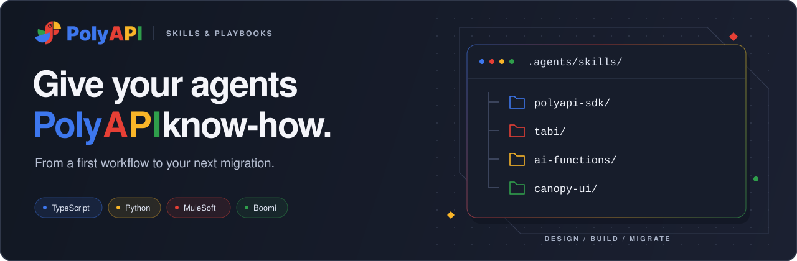

# poly-skills



Practical skills and agent playbooks for building with PolyAPI. Give your coding
agent the context to design workflows, use the SDK, train API Functions, build
Canopy apps, and migrate integrations from MuleSoft or Boomi.

**[Explore the catalog](./CATALOG.md)** · [Quick start](#quick-start) ·
[Contribute](#contributing)

## Find your starting point

Pick a language pack, add shared PolyAPI skills, and bring in migration playbooks
when you need them. Each pack links to its skills and supporting references.

| Pack | What you can do |
| --- | --- |
| [TypeScript](./polyapi-typescript/README.md) | Build workflows with SDK, coding, artefact, API training, and runtime-testing guidance. |
| [Python](./polyapi-python/README.md) | Build workflows with Python SDK, coding, artefact, and API training guidance. |
| [PolyAPI foundations](./polyapi-common/README.md) | Choose constructs, interpret designs, work with AI Functions, MCP servers, and Tabi, build Canopy apps, and document workflows. |
| [MuleSoft → PolyAPI](./mulesoft-to-polyapi/README.md) | Extract and redact source, analyse Mule XML and RAML, generate schemas, and guide implementation. |
| [Boomi → PolyAPI](./boomi-to-polyapi/README.md) | Download and analyse Boomi components, derive schemas, and guide TypeScript conversion. |
| [General engineering](./general/README.md) | Apply reusable clean-code and Markdown authoring guidance. |

## Go straight to the task

- **Train an API from OpenAPI or Swagger** — use the
  [TypeScript](./polyapi-typescript/skills/api-function-training/SKILL.md) or
  [Python](./polyapi-python/skills/api-function-training/SKILL.md) training skill.
- **Build a customer-facing app** — start with
  [Canopy UI](./polyapi-common/skills/canopy-ui/SKILL.md) for Application JSON,
  forms, collections, actions, and PolyUI deployment.
- **Choose where state belongs** — use
  [PolyAPI constructs](./polyapi-common/skills/polyapi-constructs/SKILL.md) for
  Vari, secrets, and Tabi decisions, then
  [Tabi](./polyapi-common/skills/tabi/SKILL.md) for table operations and retention.
- **Design an AI Function** — use
  [AI Functions](./polyapi-common/skills/ai-functions/SKILL.md) for typed
  contracts, tool references, and the path toward deterministic code.
- **Expose functions to external AI clients** — use
  [MCP servers](./polyapi-common/skills/mcp-servers/SKILL.md) to choose safe
  tools, fix their bindings, and deploy Flow MCP server artefacts.
- **Clean up Flow resources or inspect server-function logs** — use the
  [TypeScript](./polyapi-typescript/skills/polyapi-sdk/references/FLOW.md) or
  [Python](./polyapi-python/skills/polyapi-sdk/references/FLOW.md) Flow reference.

## Quick start

A skill is a folder containing a `SKILL.md` entrypoint and, where needed,
references, scripts, or templates. Copy the skills you need into your project's
`.agents/skills/` directory, then tell your agent when to use them.

Clone this repo alongside your project. From your **project root**, this example
installs shared construct guidance and the TypeScript SDK skill:

```bash
git clone https://github.com/polyapi/poly-skills.git ../poly-skills
mkdir -p .agents/skills
cp -R ../poly-skills/polyapi-common/skills/polyapi-constructs .agents/skills/
cp -R ../poly-skills/polyapi-typescript/skills/polyapi-sdk .agents/skills/
```

For Python, use `polyapi-python` in place of `polyapi-typescript`.
Copy each **whole skill folder**, including supporting files, and keep its name.
Add any companion skills required by the selected skill or playbook.

Add relevant entrypoints to your root `AGENTS.md`, for example:

```markdown
- Before choosing PolyAPI constructs, load
  `.agents/skills/polyapi-constructs/SKILL.md`.
- Before writing or deploying PolyAPI code, load
  `.agents/skills/polyapi-sdk/SKILL.md`.
```

For a new repo, use the
[TypeScript](./polyapi-typescript/AGENTS.md) or
[Python](./polyapi-python/AGENTS.md) pack's `AGENTS.md` as a starting point.
For an existing repo, merge the relevant guidance into its current instructions.

### Keep the files in the right place

| Source | Destination in your project |
| --- | --- |
| `<pack>/skills/<skill>/` | `.agents/skills/<skill>/`, including all supporting files |
| `<pack>/AGENTS.md` | Root `AGENTS.md`, adapted to your project |
| `<pack>/specialised_agents/*.md` | `agents/` or `specialised_agents/`, referenced by root `AGENTS.md` |

Repo entrypoints and specialised playbooks belong outside `.agents/skills/`.
When copying a playbook, copy its required skills too and adapt referenced paths.

## Contributing

Found a missing pattern or an unclear instruction? Contributions are welcome.

1. For larger changes, [open an issue](https://github.com/polyapi/poly-skills/issues)
   first so we can agree on the approach.
2. Fork and clone this repository, then create a branch for your change.
3. Follow the [skill-authoring guide](./.agents/skills/writing-skills/SKILL.md).
   Keep skills self-contained and update the [catalog](./CATALOG.md) and affected
   pack READMEs when skills are added, removed, renamed, or moved. Never include
   credentials or customer data.
4. Verify links and examples, and try changed instructions in a representative
   project. Explain what you tested and any limitations.
5. Open a focused pull request against `main`, explaining the change and how you
   checked it. A maintainer will review it.

The internal `.agents/skills/` directory contains maintainer guidance; browse the
packs above for skills intended to be copied into your projects.

## License

Licensed under the [MIT License](LICENSE).
